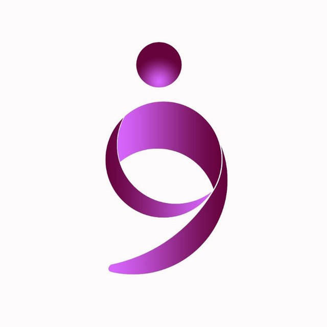

# Hi, I'm Nesma AbdelMaboud 👋

**.NET Backend Developer | .NET Mentor at CIS Team MU**

Building backend systems with ASP.NET Core, with a focus on software architecture, clean code, and maintainability.

Currently working on **Focus Lens** and pursuing my final year at Mansoura University.

---

## 📂 Projects

<h3>
  
  Focus Lens — AI-Powered Student Focus Platform
</h3>

An educational platform featuring AI-powered study sessions, behavior analysis, gamification, and parental insights.

- **Architecture:** Clean Architecture, CQRS, MediatR.
- **Backend:** ASP.NET Core Web API, EF Core, SQL Server.
- **Authentication:** ASP.NET Core Identity, JWT, Refresh Tokens.
- **Testing & Logging:** xUnit, Serilog.
- **Integration & Validation:** AI-powered study services, FluentValidation.

<h3>
  
  Fasally — Custom Tailoring Marketplace
</h3>

A marketplace connecting customers with tailors to request and manage customized clothing orders.

- **Architecture:** Layered Architecture, Result Pattern.
- **Backend:** ASP.NET Core Web API, EF Core, SQL Server.
- **Authentication:** ASP.NET Core Identity, JWT, Google Authentication.
- **Authorization:** Role-based and Permission-based Authorization.
- **Tools & Libraries:** Mapster, Serilog, OpenAPI, Scalar.

### [EduBridge — University Team Collaboration Platform](https://github.com/nesmaabdelmaboad/EduBridge)

A platform connecting students and academic staff to manage graduation projects, form teams, and collaborate on project ideas.

- **Backend:** ASP.NET Core Web API, MVC, EF Core, SQL Server.
- **Authentication:** ASP.NET Core Identity, JWT, Refresh Tokens.
- **Tools & Libraries:** FluentValidation, Mapster, Serilog, MailKit.

---

## 🛠️ Languages & Tools

---

## 📊 GitHub Stats

<table>
  <tr>
    <td colspan="2">
      
    </td>
  </tr>
  <tr>
    <td>
      
    </td>
    <td>
      
    </td>
  </tr>
  <tr>
    <td>
      
    </td>
    <td>
      
    </td>
  </tr>
</table>

---

## 📫 Get in Touch

